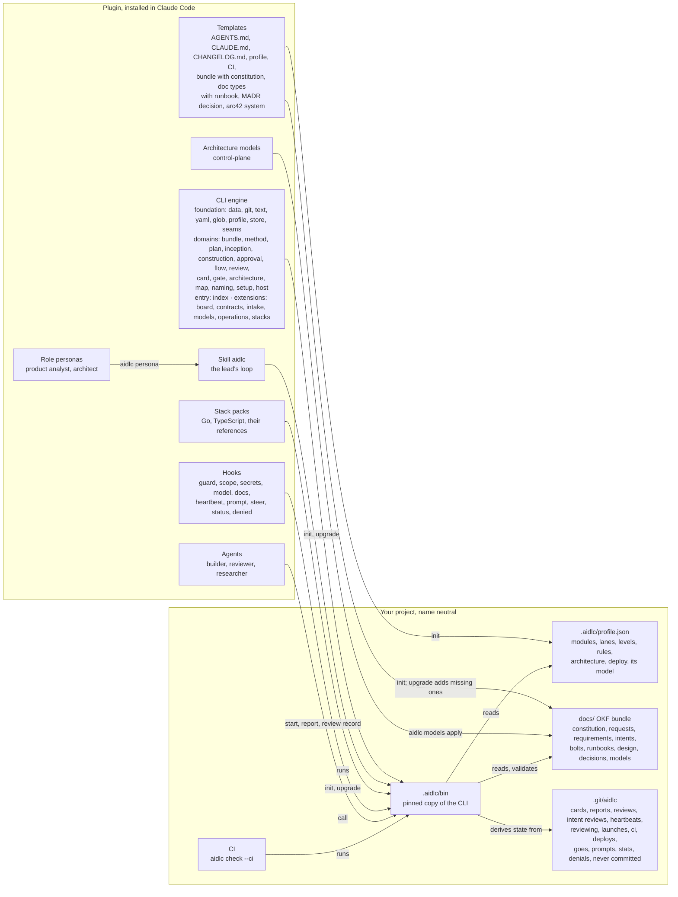

# aidlc-team

[](https://github.com/Scrollout/aidlc-team-plugin/actions/workflows/ci.yml)
[](https://github.com/Scrollout/aidlc-team-plugin/tags)
[](https://nodejs.org/en/about/previous-releases)
[](plugin/cli)
[](LICENSE)

A Claude Code plugin that runs the AI-DLC lifecycle (Inception, Construction, Operations) in any project. It takes a request in plain prose from anyone, keeps it word for word and turns it into an intent; it can bring a proven architecture model to a new or existing project; it uses an OKF docs bundle and a small team of agents, and every rule that matters is enforced by a CLI or a hook, not by prose.

```
/plugin marketplace add Scrollout/aidlc-team-plugin
/plugin install aidlc-team@scrollout.net
```

## How AI-DLC runs with the plugin

You describe what you want; the lead turns it into the method, and `aidlc next` names one action at a time, derived from git and the docs.

- **Inception:** an intent with a pathway (greenfield, feature or brownfield) and the steps it requires: questions answered by option, domain docs, platform facts. Requirements are stated in EARS, decisions in MADR 4.0, and you approve each one-way door on its own. A researcher writes a cited digest for a question nobody can answer yet.
- **Construction:** the intent ships in increments, increment 1 the walking skeleton on its target. Each bolt binds one domain and has acceptance criteria as Given/When/Then. A builder writes the tests first inside the bolt's scope, a reviewer with fresh context checks each focus (at most 3 fix rounds before you decide), and the merge gate proves each level with the code reverted. Merges carry Unit, Card, Review, Tested and Proof trailers.
- **Operations:** deploy check, then your go (type `release I-<n>`), then smoke; `rollback I-<n>` is yours too. A requirement counts as delivered only when its tests are in a release, and changes land in `CHANGELOG.md` per Keep a Changelog.

The workflow, generated from the rules the CLI enforces (pathways and state transitions in `cli.json`):

```mermaid
flowchart LR
  subgraph Inception
    greenfield([greenfield]) --> questions --> domains --> facts --> approved
    feature([feature]) --> questions --> domains --> facts --> approved
    brownfield([brownfield]) --> map --> kinds --> business --> baseline --> questions --> domains --> facts --> approved
    model([model]) --> questions --> research --> modelDoc --> approved
  end
  subgraph Construction
    b_approved[approved] -->|builder starts| b_building[building]
    b_building[building] -->|aidlc report| b_reported[reported]
    b_reported[reported] -->|reviewer starts| b_reviewing[reviewing]
    b_reviewing[reviewing] -->|pass in every focus| b_reviewed[reviewed]
    b_reviewed[reviewed] -->|aidlc merge| b_merged[merged]
  end
  subgraph Operations
    i_merged[merged] -->|deploy check passes or none set| i_checked[checked]
    i_checked[checked] -->|release on a pushed green base passes, smoke too or none set| i_released[released]
  end
  approved --> b_approved
  b_merged --> i_merged
```

<!-- generated: workflow -->

<!-- /generated -->

## What the plugin installs and what it writes into a project



The CLI keeps working with the plugin uninstalled: the project's pinned copy, its docs and CI stay green on their own. A later MCP or A2A adapter can call the same engine ([decision 0006](docs/decisions/0006-engine-behind-adapters.md)).

## Read more

- [Principles](docs/constitution/principles.md): the rules every change is checked against.
- [Architecture in arc42](docs/design/arc42.md): the plugin's own architecture, section by section, with a C4 component view of the CLI.
- [Overview](docs/design/overview.md): goals, budgets, releases, repo layout; [Library and extensions](docs/design/library.md): how the CLI is laid out.
- [Standard formats](docs/design/standards.md): MADR, Given/When/Then, EARS, Keep a Changelog, arc42 and C4.
- [Generated diagrams](docs/design/diagrams/index.md): words, workflow, states, kinds, bundle types, naming grammar and every check code.
- [Decisions](docs/decisions/index.md), [Changelog](CHANGELOG.md), [Roadmap](docs/roadmap/index.md): the milestone plans; the newest one is the current plan.

## License

[MIT](LICENSE)
