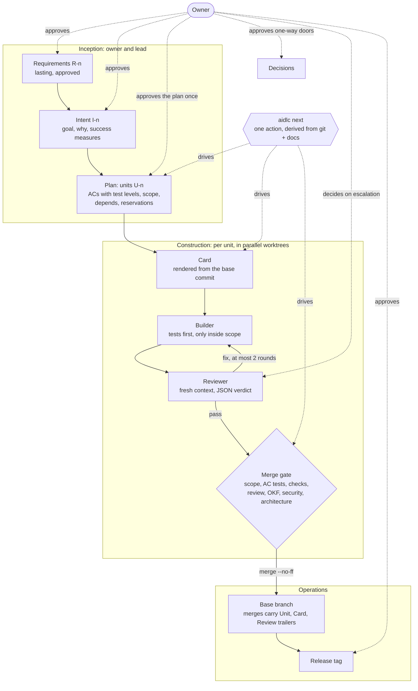
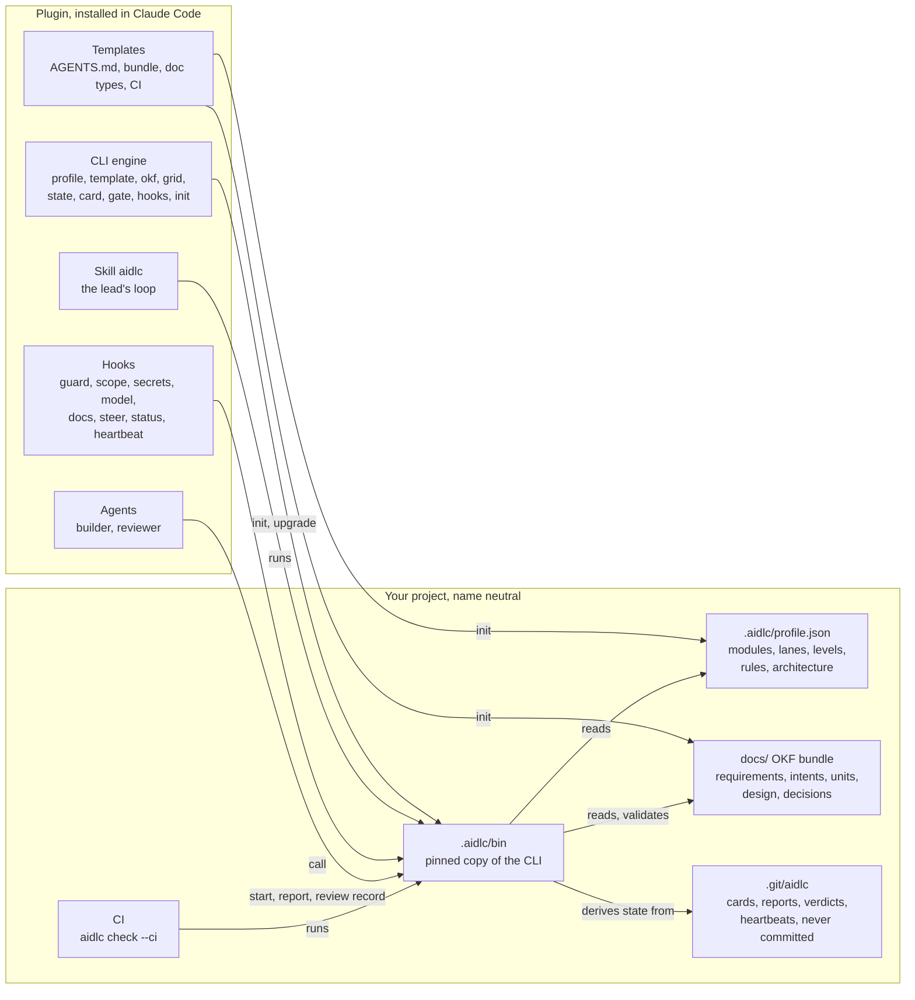

# aidlc-team

A Claude Code plugin that runs the AI-DLC lifecycle (Inception, Construction, Operations) in any project. It uses an OKF docs bundle and a small team of agents, and every rule that matters is enforced by a CLI or a hook, not by prose.

```
/plugin marketplace add Scrollout/aidlc-team-plugin
/plugin install aidlc-team@aidlc-team
```

## How AI-DLC runs with the plugin



## What the plugin installs and what it writes into a project



The CLI keeps working with the plugin uninstalled: the project's pinned copy, its docs and CI stay green on their own. A later MCP or A2A adapter can call the same engine ([decision 0006](docs/decisions/0006-engine-behind-adapters.md)).

## Read more

- [Principles](docs/constitution/principles.md): the ten rules every change is checked against.
- [Overview](docs/design/overview.md): goals, budgets, releases, repo layout.
- [Grid](docs/design/grid.md), [State](docs/design/state.md), [Verification](docs/design/verification.md), [Requirements and architecture checks](docs/design/architecture.md).
- [M1 plan](docs/roadmap/m1.md): units, acceptance criteria and what is built.

## License

[MIT](LICENSE)
