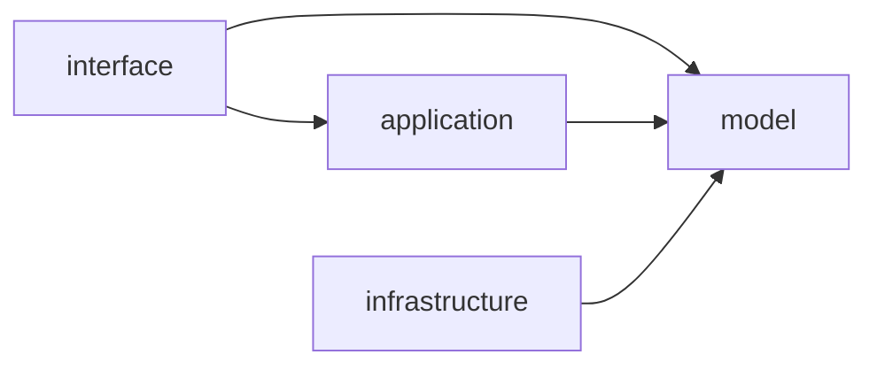

| from \ to | domain | pipeline | foundation | adapter | runtime | extension | delivery |
|---|---|---|---|---|---|---|---|
| domain | surface |  | yes |  |  |  |  |
| pipeline | surface |  | yes |  |  |  |  |
| foundation |  |  | yes |  |  |  |  |
| adapter |  |  | yes |  |  |  |  |
| runtime | yes | yes | yes | yes |  |  |  |
| extension | surface |  | yes |  |  |  |  |
| delivery | yes | yes | yes | yes | yes | yes | yes |

