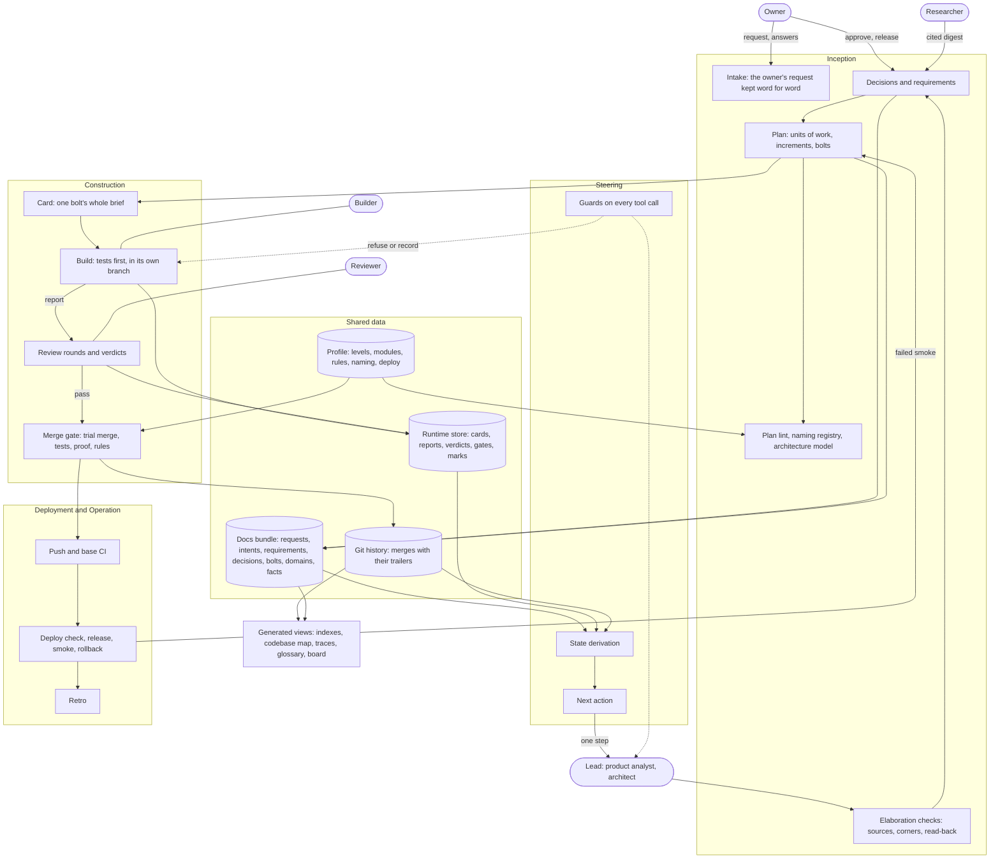

# Building blocks and data

# Blocks
| Block | Decides or produces | Reads | Writes |
|---|---|---|---|
| Intake | The owner's request with a sentence id each, and the proposed pathway, stack and lane | The owner's words | Docs bundle |
| Elaboration checks | Whether every claim cites a source, every corner is settled, the read-back is confirmed | Docs bundle | Findings |
| Decisions and requirements | One-way doors in MADR, lasting requirements in EARS | Research digests, facts | Docs bundle |
| Plan | Units of work, increments with the walking skeleton first, bolts with Given/When/Then ACs | Requirements, decisions | Docs bundle |
| Plan lint, naming, architecture model | Whether the plan, names and module shape follow the rules before approval | Profile, docs bundle | Findings |
| State derivation | Every doc's and bolt's state, never stored | Docs bundle, runtime store, git history | - |
| Next action | The one allowed step, from an ordered list in data | State | - |
| Guards | Refuse a tool call that breaks a rule, keep agents in flight marked | Profile, runtime store | Runtime store |
| Card | A bolt's brief, its hash pinning what it was drawn from | Docs bundle, profile | Runtime store |
| Build | Tested code inside the bolt's scope, and a report | Card | Branch, runtime store |
| Review rounds | A verdict per focus, findings with evidence, fix rounds up to a limit | Card, diff, test runs | Runtime store |
| Merge gate | Merge or refuse, as a list of codes | Profile, docs bundle, runtime store, branch | Git history |
| Push and base CI | Pushes only gate merges; waits for the base's CI | Git history | Runtime store |
| Deploy check, release, smoke, rollback | Whether the merged base runs on the target; the owner releases | Profile, git history | Runtime store |
| Retro | Measures and proposed rule changes | Runtime store, git history | Docs bundle |
| Generated views | Indexes, codebase map, traces, glossary, context map; the board as a one-way projection | Docs bundle, git history | Docs bundle, board |

# Who owns what
- The owner owns intent, plan approval, one-way doors and release. Only the owner's typed command stamps an approval ([Approvals](../approvals.md)).
- The lead does what next names and nothing else; agents get one card or brief each and record their own results ([Skill and agents](../prompts.md)).
- State is derived from the shared data on every call, so a cleared or crashed session resumes from disk ([State](../state.md), [Resume](../resume.md)).

Technology and deployment: [Technical view](technical.md). One bolt in motion: [Runtime view](runtime.md).
