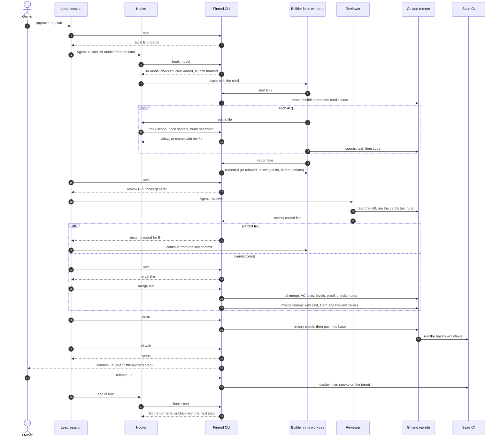

# One bolt, start to end

# Notes
- Each step the lead takes is the one `next` printed; the Stop hook sends it back to work while a step of its own is due, and lets the turn end for an owner step, a question to the owner, or a running agent ([Steering](../steering.md)).
- A builder's tool calls keep its bolt's heartbeat fresh; a quiet builder with no report is restarted from its branch after 12 minutes ([Agents in flight](../in-flight.md)).
- The gate merges the bolt as a whole commit and reruns its tests on the merge result, then with its code reverted, where they must fail ([Merge mechanics](../gate.md)).

Logical blocks: [Logical view](logical.md). Parts and connections: [Technical view](technical.md).
