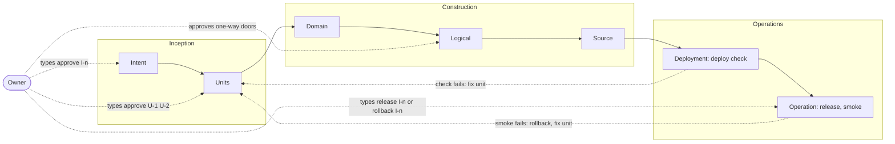

# Rows

| Row | Output | Deterministic check | Owner approves |
|---|---|---|---|
| Intent | `intents/I-<n>-<slug>.md`: goal, why, success measures, out of scope | required sections | yes |
| Units | `units/U-<n>-<slug>.md`: stories, ACs (`AC-<k>`), NFRs, risks, `depends`, `modules`, `scope`, `reserves` | DAG acyclic, AC IDs unique, scopes of parallel units disjoint, reservations unique, size | the plan, once |
| Domain | `# Domain` in the unit doc: entities, their one owning component, interactions; no technology | `PLAN-DESIGN` in the full lane ([Design rows](design-rows.md)) | with the plan |
| Logical | `# Logical` in the unit doc + decision docs | `PLAN-DESIGN` in standard and full; decision has options, choice, why | with the plan; one-way doors as decisions |
| Source | code + tests tagged `U-<n>/AC-<k>`, written first | every AC tagged by a test at its declared level; diff inside scope; module checks green; review verdict | no |
| Deployment | the package the profile's CI builds | profile `deploy.check` commands | no |
| Operation | release record or tag, runbook link | profile `deploy.run`, `release`, `deploy.smoke`; `deploy.rollback` on a failed smoke ([Intent states](intent-states.md)) | yes, by typing `release I-<n>` |

Paths are relative to the project's bundle (profile `docs.bundle`).

# Unit doc
The ID comes from the file name, `units/U-<n>-<slug>.md`. Fields live in the frontmatter and ACs in the body:
```
---
type: Unit
intent: I-2
depends: [U-3]
modules: [api]
scope: ["internal/pricing/**"]
reserves: [migration regional/0005]
---
- AC-1 (unit): price rounds half-even per currency.
```
Plan lint checks the plan before approval; its codes are in [Plan lint](plan-lint.md).

# Plan, execute, validate
Every cell runs the same loop:
1. **Plan:** the lead drafts and asks the owner clarifying questions, offering 2-3 options with trade-offs where a choice is real.
2. **Execute:** the lead (doc rows) or a builder (Source) produces the output.
3. **Validate:** the CLI check for the row, then the reviewer for Logical and Source.

The owner's checkpoint is the plan of an approval row, where a correction is cheapest.

# Lanes
| Lane | Rows run | Picked when |
|---|---|---|
| quick | Source (checks only, no reviewer) | every changed path matches `lanes.quick` (e.g. `docs/**`, `*.md`) |
| standard | Units, Logical (section), Source | default |
| full | all rows, plus specialist review | any path matches `lanes.full` or a specialist's globs (auth, migrations, contracts) |

The CLI computes the lane from the unit's `scope` before work and from the diff at merge; the higher wins. The model may raise a lane, never lower it.

Globs: `**` spans folders, `*` and `?` stay inside one, and a pattern without `/` matches the file name at any depth unless it starts with `/`, as in `.gitignore`. Diff paths are anchored at the root. A scope or path is quick when it lies inside a `lanes.quick` glob, and full when it overlaps a `lanes.full` or `focus` glob (scope `internal/**` overlaps `internal/auth/**`). `lane` prints the lane and the glob or path that decided it.

# Tests
Tests are the Source row's second output, derived from the ACs written in Units, so they are planned before any code exists.
- Each AC declares a level, e.g. `AC-2 (integration): …`. `profile.levels` maps each level to `paths` globs and a `run` command; the plugin defaults define `unit`, `integration` and `e2e`. The gate checks that the tagged test lives where its level says.
- Behaviour that crosses a module or the network needs `integration` or higher; unit tests alone prove only local logic. Each intent has an AC at the top level ([Plan lint](plan-lint.md), `PLAN-SLICE`).
- A fix unit always has one AC: a regression test that fails before the fix.
- Quick lane adds no tests and runs no level: the gate runs only the commands its ACs name ([Merge mechanics](gate.md#details)).

# Slices
An intent lists its vertical slices under `# Slices`, one line each, naming the units that build it once they are cut (`- Owners and the gate: U-31, U-32`). While a line names no unit the intent is not done, even when every unit it has is merged: `next` asks to cut that slice's units. So a slice planned "for later" cannot be forgotten when the first slices ship nothing and the intent counts as released (first migration: I-3 closed after 2 of its 4 slices). An intent without the section counts its units only.

Each slice is vertical, checked by `PLAN-SLICE` before approval and at every `check` ([Plan lint](plan-lint.md)), for an intent whose live units reach the product:
- An intent with more live units than `plan.sliceUnits` has the section (a smaller one is one slice), and with the section every live unit is named on a slice line.
- Each slice line naming units names one with an AC at the top level: a slice without its own end-to-end test is a layer, not a slice.
- A slice names at most `plan.sliceUnits` units (default 3): a fat slice is a layer cake in disguise.
- No unit waits on a unit of a later slice, so the first slice is the walking skeleton and each slice builds on the ones before it.
- No unit of an intent waits on a fix unit not yet merged. Fix units build in the free slots beside the slices; work a slice truly needs moves into that slice.

Why: on both migrations the plan drifted into chains of layer and hygiene units ahead of the product. The second project's only intent cut its units as layers (foundation, API kit, sign-in, tenancy) with the walking skeleton behind them, and the first project's portal and identity slices waited behind dependency and renaming fix units (owner, 2026-10-25: prevent drifting from vertical end-to-end slices).

# Vertical and horizontal specs
- `capabilities/`: one doc per user journey (vertical); written in Units.
- `architecture/`: one doc per layer or module (horizontal); updated in Logical.
- Units link to both rather than copying them.
