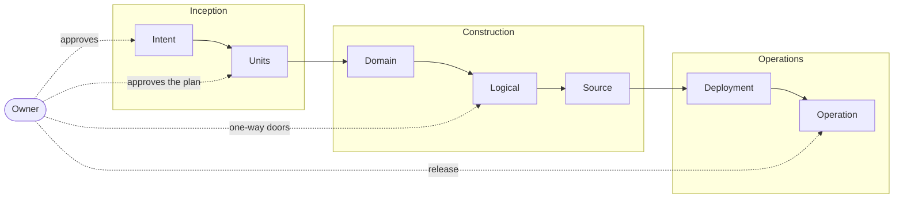

# Rows

| Row | Output | Deterministic check | Owner approves |
|---|---|---|---|
| Intent | `intents/I-<n>-<slug>.md`: goal, why, success measures, out of scope | required sections | yes |
| Units | `units/U-<n>-<slug>.md`: stories, ACs (`AC-<k>`), NFRs, risks, `depends`, `modules`, `scope`, `reserves` | DAG acyclic, AC IDs unique, scopes of parallel units disjoint, reservations unique, size | the plan, once |
| Domain | `design/U-<n>-domain.md`: entities, aggregates, context map; no technology | required sections | no |
| Logical | `## Logical` in the unit doc, or `design/U-<n>-logical.md` + decision docs | decision has options, choice, why; contract and migration checks | one-way doors only |
| Source | code + tests tagged `U-<n>/AC-<k>`, written first | every AC tagged by a test at its declared level; diff inside scope; module checks green; proof-revert (full lane); review verdict | no |
| Deployment | the package the profile's CI builds | profile `deploy.check` commands | no |
| Operation | release tag, runbook link | profile `release` command, smoke | yes |

Paths are relative to the project's bundle (profile `docs.bundle`).

# Unit doc
The ID comes from the file name, `units/U-<n>-<slug>.md`. Fields live in the frontmatter and ACs in the body:
```
---
type: Unit
intent: I-2
depends: [U-3]
modules: [api]
scope: ["internal/pricing/**"]
reserves: [migration regional/0005]
---
- AC-1 (unit): price rounds half-even per currency.
```
Plan lint compares every unit except `status: dropped` and the IDs its caller skips (U4 passes the merged ones, derived from git). Codes, all errors:
- `PLAN-DAG` a `depends` cycle (named in full) or an unknown unit.
- `PLAN-AC` a duplicate AC ID in a unit.
- `PLAN-LEVEL` an AC without a level, or with one `profile.levels` does not define.
- `PLAN-RESERVE` a malformed reservation (`<kind> <area>/<n>`), a kind `profile.reserve` lacks, or the same one in two units.
- `PLAN-SCOPE` a unit without `scope`, or two units whose scopes overlap with no `depends` path between them.
- `PLAN-SHARED` a scope naming a file only merge writes: a bundle `index.md` or `log.md`, or a `profile.shared` entry.
- `PLAN-REQ` an intent or unit citing no requirement, or an unknown one ([Architecture](architecture.md)).

# Plan, execute, validate
Every cell runs the same loop:
1. **Plan:** the lead drafts and asks the owner clarifying questions, offering 2-3 options with trade-offs where a choice is real.
2. **Execute:** the lead (doc rows) or a builder (Source) produces the output.
3. **Validate:** the CLI check for the row, then the reviewer for Logical and Source.

The owner's checkpoint is the plan of an approval row, where a correction is cheapest.

# Lanes
| Lane | Rows run | Picked when |
|---|---|---|
| quick | Source (checks only, no reviewer) | every changed path matches `lanes.quick` (e.g. `docs/**`, `*.md`) |
| standard | Units, Logical (section), Source | default |
| full | all rows, plus specialist review | any path matches `lanes.full` or a specialist's globs (auth, migrations, contracts) |

The CLI computes the lane from the unit's `scope` before work and from the diff at merge; the higher wins. The model may raise a lane, never lower it.

Globs: `**` spans folders, `*` and `?` stay inside one, and a pattern without `/` matches the file name at any depth unless it starts with `/`, as in `.gitignore`. Diff paths are anchored at the root. A scope or path is quick when it lies inside a `lanes.quick` glob, and full when it overlaps a `lanes.full` or `focus` glob (scope `internal/**` overlaps `internal/auth/**`). `lane` prints the lane and the glob or path that decided it.

# Tests
Tests are the Source row's second output, derived from the ACs written in Units, so they are planned before any code exists.
- Each AC declares a level, e.g. `AC-2 (integration): …`. `profile.levels` maps each level to `paths` globs and a `run` command; the plugin defaults define `unit`, `integration` and `e2e`. The gate checks that the tagged test lives where its level says.
- Behaviour that crosses a module or the network needs `integration` or higher; unit tests alone prove only local logic.
- A fix unit always has one AC: a regression test that fails before the fix.
- Quick lane adds no tests but runs the existing ones.

# Vertical and horizontal specs
- `capabilities/`: one doc per user journey (vertical); written in Units.
- `architecture/`: one doc per layer or module (horizontal); updated in Logical.
- Units link to both rather than copying them.
