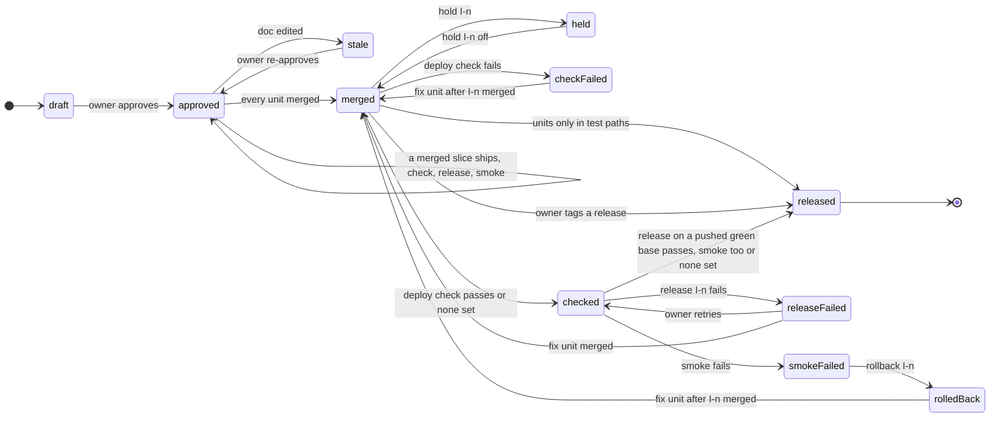

# States
`readState` gives an intent one of five states: `draft`, `approved` and `stale` from its approval ([Approvals](approvals.md)), `merged` once every unit of it merged, and `released`. While it is `merged`, `next` reads its release steps from the deploy record `.git/aidlc/deploys/I-<n>.json` and the base commit ([Deployment and operation](operations.md)); the diagram draws those steps as states of their own.

# Details
- **Back-fill shortcut:** an intent whose units' scopes all lie in the levels' test paths is released at merge; it has no release steps and needs no runbook ([Proof for back-fill tests](backfill.md)).
- **Release by tag:** without `deploy` or `release` in the profile the owner tags the release; a tag containing each unit's merge counts as released in any profile, so intents tagged before `deploy` was added stay released.
- **Check:** without `deploy.check` the release is offered at once. A check counts only for the base commit it ran on: a merged fix unit moves the base, and the check runs again.
- **Release and smoke:** the owner types `release I-<n>`; the guard lets the lead's `aidlc release I-<n>` through once ([0012](../decisions/0012-typed-go-for-release-and-rollback.md)). It runs `deploy.run` and `release`, then `deploy.smoke`. The intent is released once the release passed and, with `deploy.smoke` set, the smoke after it.
- **Smoke failed:** a ⛔ stop before any other work, held or not, until the owner types `rollback I-<n>`; then a fix unit from the smoke output, `aidlc fix … --after I-<n>`.
- **Increment release:** an `approved` intent whose newest merged increment is not in its last passing release runs the release steps too, while its next increments build; only its own bolts count ([Increments and bolts](increments-and-bolts.md#shipping-an-increment)).
- **Held:** `hold I-<n>` parks every release step but a failed smoke, until `hold I-<n> off`.
- The next intent's units are built while one waits on its release steps ([State](state.md#next)).
