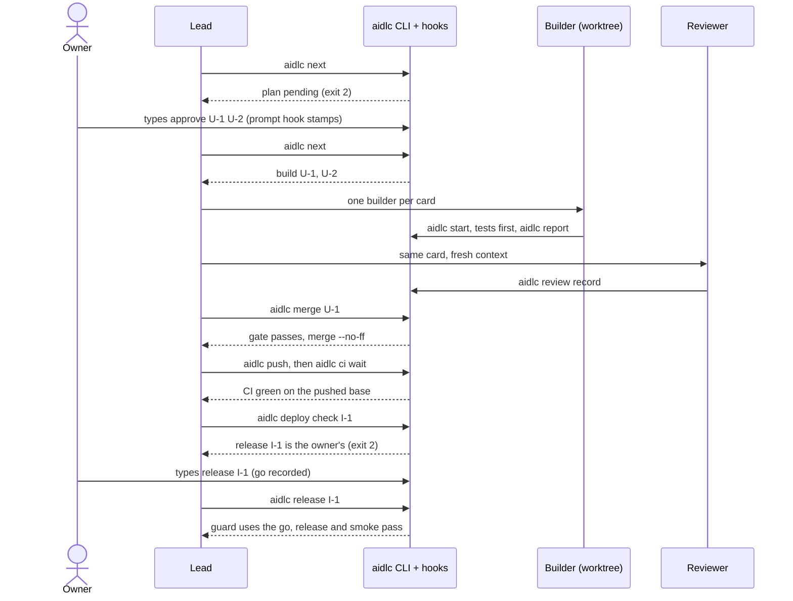

# Goals
- Usable in any project: `init` renders a profile, AGENTS.md and an OKF bundle from templates.
- Deterministic: the CLI computes the next allowed step; hooks block rule breaks at the action.
- Cheap and fast: small always-on context, Sonnet builders, Opus only for review, lanes sized to risk.
- Autonomous: the owner approves intent, plan, one-way doors and release; agents do the rest.
- Extensible: rule layers (plugin, project, personal) and overridable templates.

# Diagrams
The whole lifecycle and the plugin's parts are drawn in the [README](../../README.md); one unit's path to release is below.

# How a unit flows

# Non-goals
- Sandboxing the shell. The guard stops mistakes, not attackers.
- Built-in deployment pipelines. Operation commands come from the project profile.
- Simulated meetings (multi-agent debates, PM/tech-lead/architect personas).
- Tracking the plugin's own process with the plugin.

# Budgets (hard limits)
| Item | Limit |
|---|---|
| Always-on context added to a project session | 1,500 tokens |
| Generated AGENTS.md | 60 lines |
| SessionStart status injection | 1,000 chars |
| Skill body / agent prompt | 3 KB each |
| Skill and agent descriptions | 300 chars each |
| Unit card | 100 lines |
| CLI source (`plugin/cli/`) | 5,000 lines ([0016](../decisions/0016-the-cli-budget-is-5000-lines.md)) |
| Hook timeout | 10 s explicit, `onFailure: "block"` on blocking hooks |
| Blocking hook run time | 500 ms beyond a bare `node` start timed beside it, median of 5 calls on a small project |

# Repo layout
- `plugin/.claude-plugin/plugin.json`: `name` is `aidlc-team` (kebab-case, no reserved prefix, and never `aidlc`, which projects use for the CLI and `.aidlc/`), the only `version`; users stay on a version until it is bumped.
- `plugin/cli/aidlc.mjs`, `plugin/cli/lib/*.mjs`: the CLI.
- `plugin/hooks/`: thin wrappers that call the CLI.
- `plugin/agents/`: `builder.md`, `reviewer.md`, `researcher.md`.
- `plugin/skills/aidlc/SKILL.md`: the lead's loop.
- `plugin/templates/`: everything `init` renders.
- `.claude-plugin/marketplace.json`: marketplace `scrollout.net`, one entry `aidlc-team` with `source: "./plugin"`, so tests and docs never ship. Install id: `aidlc-team@scrollout.net`.

# Releases
- `version` lives only in `plugin/.claude-plugin/plugin.json`, never in the marketplace entry. Users stay on a version until it changes.[^cc-host]
- A release carries two annotated tags on the same commit, chosen by the owner:
  - `v<version>`, the standard semver tag for people and GitHub Releases.
  - `aidlc-team--v<version>`, made by `claude plugin tag plugin --push`. The command first checks that the manifest and the marketplace entry agree and that the tree is clean.[^cc-tag] Plugin dependency ranges resolve against this form.
- The version always matches a tag. A commit that changes `plugin/` also bumps `version` (semver: new commands or rules are minor, fixes are patch), and is tagged once it is on `main`. A test fails when `plugin/` differs from the tag of the current version. CI checks on a tag push that either tag matches `plugin.json`. The owner approves each release (principle 5).
- Users can pin a release with `/plugin marketplace add Scrollout/aidlc-team-plugin#v<version>`.[^cc-host]
- The vendored CLI's `VERSION` file holds the same version, so a project records which release judges it.

# Glossary
The words the plugin and its projects use, each at one scale, with the AI-DLC term it maps to: [Canonical model](canonical-model.md#words).

[^cc-host]: Host and maintain a marketplace
[^cc-tag]: Plugin commands reference, plugin tag
