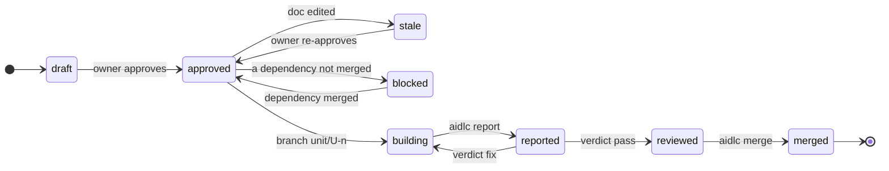

# Sources of truth
| Fact | Where it comes from |
|---|---|
| Intent and plan approved | a `human:` entry in the doc's OKF `verified` field, with `verified_hash` still matching the content |
| Unit exists, its deps, scope | the unit doc |
| Unit in progress | branch `unit/U-<n>` exists |
| Unit reviewed | `.git/aidlc/reviews/U-<n>.json`, keyed by diff hash: a `pass` in `general` and in every focus the gate requires |
| Unit done | a merge commit on the base branch with trailer `Unit: U-<n>` |
| Released | a tag reachable from the base containing the intent's units |

`.git/aidlc/` sits in git's common dir, so every worktree sees the same runtime data, and it is never committed.

# Unit states

# Approvals
- Approval uses OKF's own trust field. `aidlc approve` takes one or more docs (IDs or paths). It keeps earlier `verified` events, appends `{ by: human:<git user.email>, at }`, sets `status: stable`, and writes `verified_hash`: sha256 of the body plus the parsed frontmatter as sorted JSON, without `verified`, `verified_hash`, `status`, `hold`, `priority` and `board` ([Board](board.md)). So YAML formatting, a hold or a board field never stales a doc. A quick-lane fix unit needs no approval.
- Agents cannot approve: the guard denies `aidlc approve` from a tool call, and the scope hook denies any edit to `verified` or `verified_hash`. Only the owner approves, by `!` or prompt ([0009](../decisions/0009-approval-prompt.md)), or a class they delegated ([0008](../decisions/0008-delegated-approvals.md)).
- Editing an approved doc makes it `stale`; `next` then asks for re-approval.

# next
`aidlc next` prints one line: the single next action and the command or agent that performs it, e.g. `build U-3 (card: aidlc card U-3)`. It exits 2 when the action waits on the owner, and prints an owner command runnable as is (`aidlc` is shorthand in the docs). Order:
1. A merge cut off midway → continue it.
2. Any `stale` approval → re-approve.
3. A draft intent, requirement or unit with open points (a `<…>` placeholder left from its template, or an item under `Open questions`) → finish elaborating it with the owner, naming them; no approval or unit work before that.
4. No intent yet: elaborate one; in an adopted project with none, the migration intent ([Everyday paths](paths.md#adopting-an-existing-project)). Intent not approved → request approval; then the draft requirements it and its units cite.
5. Plan not approved → draft units and request approval.
6. Reviewed units → merge in DAG order; a held unit waits; a refused one is not offered again for the same base and diff.
7. Verdict `escalate` in any focus → the owner decides; their re-approval turns it into `fix` and restarts the count. Verdict `fix` → fix round (none while its builder runs); the card lists the findings. A verdict older than the builder's last report no longer counts.
8. A builder that reported `stopped` → the lead fixes the spec (re-approved) or the cause; the builder restarts from the card.
9. Reported, not reviewed → review, naming the first required focus without a `pass` for the current diff ([Skill and agents](prompts.md#review)).
10. Building with a stale heartbeat (over 2 min) and no report → restart its builder.
11. Approved, unblocked units → build, on one line; up to `parallel.max` in flight, with scopes disjoint from units in flight.
12. Builders running → wait.
13. Intent merged, untagged → release with the owner; meanwhile 4–12 serve the next one.

`aidlc status` prints the same state as a short table; SessionStart injects it (max 1,000 chars) in place of handoff files.

# Surviving a clear, crash or new session
Rule: nothing that matters lives only in the conversation. Everything below is on disk before the turn that produced it ends.
| Could be lost | Where it lives instead |
|---|---|
| Owner's answers during elaboration | the draft intent/unit doc: the lead writes each answer before asking the next question; open ones stay under `## Open questions` |
| Owner instructions about the plan ("hold U-4", "U-2 first") | plan fields set by `aidlc hold`, `aidlc priority`, never chat memory |
| Builder's work | WIP commits on `unit/U-<n>` after every passing test; the worktree is on disk |
| Builder's report | `aidlc report U-<n>` writes `.git/aidlc/reports/U-<n>.json`; the builder runs it before returning |
| Reviewer's verdict | the reviewer runs `aidlc review record` itself; the lead never relays it |
| Which builders are running | a heartbeat file per unit, touched by a PostToolUse hook in its worktree |
| A merge cut off midway | detected from `MERGE_HEAD`; `next` says abort or continue |

On resume (SessionStart `startup`, `resume`, `clear`, `compact`):
1. The hook injects `aidlc status` plus one line: load the `aidlc` skill and run `aidlc next`.
2. A unit with a fresh heartbeat (under 2 min) is still running: wait, don't start a second builder.
3. A unit with a stale heartbeat and no report is interrupted: `next` restarts its builder from the same card, told to continue from the branch's last commit.
4. Reports and verdicts on disk are picked up as if the old session had received them.

Result: after a clear, `next` returns the same action it would have returned before, with no duplicate builder and no lost work.
