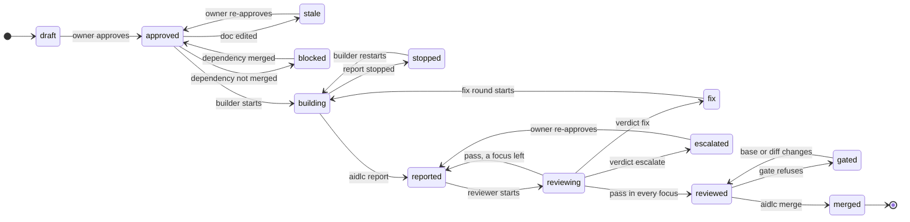

# Sources of truth
| Fact | Where it comes from |
|---|---|
| Intent and plan approved | a `human:` entry in the doc's OKF `verified` field, with `verified_hash` still matching the content |
| Unit exists, its deps, scope | the unit doc |
| Unit in progress | branch `unit/U-<n>` exists |
| Unit reviewed | `.git/aidlc/reviews/U-<n>.json`, by diff hash: a `pass` in `general` and each focus the gate needs |
| Unit done | a merge commit on the base branch with trailer `Unit: U-<n>` |
| Released | every bolt merged, every increment line naming bolts, and a release holding each merge: a tag, a passed `aidlc release` (and smoke), or test-only scopes |

`.git/aidlc/` sits in git's common dir: every worktree sees it; it is never committed.

# Unit states

A quick-lane unit without an intent starts `approved`; its report makes it `reviewed`, with no review. Intents: [Intent states](intent-states.md).

# Approvals
Intents, requirements, units and one-way-door decisions carry the owner's approval; an edit stales it ([Approvals](approvals.md)).

# next
`aidlc next` prints one line: the next action and the command or agent for it. Badges (`state.badges`): 👉 an owner step, ⛔ a refusal or stop. It exits 2 when the owner acts. Order:
1. A merge cut off → continue it. A failed release or smoke → ⛔ the owner retries or rolls back, then a fix unit ([Deployment and operation](operations.md#details)). A red base CI → a fix unit; only fix units build or merge ([CI on the base](base-ci.md)). Any doc held with `research: <question>` unanswered in `research/` → research it (`aidlc research <doc>`), or wait for its researcher ([0010](../decisions/0010-research-and-advice.md)); the digest ends that hold.
2. Any `stale` approval, decisions included → re-approve, with the drafts the stale docs cite.
3. A draft intent, requirement or unit with open points (a template `<…>` placeholder outside plan fields, an `Open questions` item) → finish elaborating it with the owner, naming them; no approval or unit work first. A draft intent that links no decision is also asked to draft the decisions it needs while the owner answers.
4. No intent yet: elaborate one; in an adopted project with none, the migration intent ([Everyday paths](paths.md#adopting-an-existing-project)). Intent not approved → request approval, with the draft requirements it cites.
5. Plan not approved → first the draft decisions the intent links: finish those with open points, then request their approval; an architecture choice shapes the cut. Then draft units, request approval with the draft decisions and requirements they cite.
6. Reviewed units → merge in DAG order, once each AC has a tagged test on the branch (else back to the builder). One the gate refused → ⛔ the owner, until the base or the diff changes.
7. Verdict `escalate` in any focus → the owner decides; their re-approval marks its findings answered on the card and sends the unit straight to review.
8. A builder that reported `stopped` → the lead fixes the spec (re-approved) or the cause; the builder restarts, and is building from then on. Verdict `fix` → fix round, findings on the card, none while its builder runs. A verdict older than the builder's last report no longer counts.
9. Reported, not reviewed → review, one reviewer per required focus without a `pass` for the current diff, in parallel ([Skill and agents](prompts.md#review)).
10. Building with a stale heartbeat ([Agents in flight](in-flight.md)) and no report → restart its builder. A merged unit still in a worktree → stop its builder, remove it.
11. Approved, unblocked units → build, on one line; up to `parallel.max` in flight, with scopes disjoint from every unit started and not merged, intent units before fix units at the same priority; with `ci.wait`, the base pushed first and `ci wait` run beside them.
12. Builders running → wait. An increment line naming no bolt once the intent's bolts merged → cut them ([Increments](increments-and-bolts.md)).
13. Intent merged, not released → its release steps: a hold, the deploy check, a fix unit, the release ([Deployment and operation](operations.md#details)). 4–12 serve the next intent meanwhile. All released → the owner clears the lead's session first ([Resume](resume.md#between-intents)).

A gated, escalated or stopped unit holds back no other unit's review, fix or restart. An owner gate in steps 2–5 holds back only the units that wait on its docs: `next` first returns an action of steps 6–11 for the other units, then the gate. A held unit gets none until released. An action auto mode refused at this commit goes to the owner: `aidlc approve <docs>` for a delegated approval, else the refused command ([Hook checks](hook-checks.md)).

`aidlc status` prints it as a table; SessionStart injects it (≤ 1,000 chars).

# Surviving a clear, crash or new session
All that matters is on disk before a turn ends: [Resume](resume.md).
