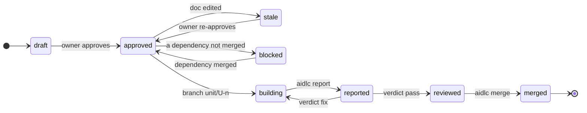

# Sources of truth
| Fact | Where it comes from |
|---|---|
| Intent and plan approved | a `human:` entry in the doc's OKF `verified` field, with `verified_hash` still matching the content |
| Unit exists, its deps, scope | the unit doc |
| Unit in progress | branch `unit/U-<n>` exists |
| Unit reviewed | `.git/aidlc/reviews/U-<n>.json`, keyed by diff hash: a `pass` in `general` and each focus the gate requires |
| Unit done | a merge commit on the base branch with trailer `Unit: U-<n>` |
| Released | a tag reachable from the base containing the intent's units |

`.git/aidlc/` is in git's common dir: every worktree sees it, and it is never committed.

# Unit states

# Approvals
Intents, requirements, units and one-way-door decisions carry the owner's approval; editing one makes it `stale` ([Approvals](approvals.md)).

# next
`aidlc next` prints one line: the single next action and the command or agent that performs it. It exits 2 when the owner acts, printing a runnable owner command. Order:
1. A merge cut off midway → continue it. A doc held with `research: <question>` unanswered in `research/` → research it, or wait for its researcher ([0010](../decisions/0010-research-and-advice.md)); the digest releases that hold.
2. Any `stale` approval → re-approve.
3. A draft intent, requirement or unit with open points (a template `<…>` placeholder outside plan fields, or an `Open questions` item) → finish elaborating it with the owner, naming them; no approval or unit work first.
4. No intent yet: elaborate one; in an adopted project with none, the migration intent ([Everyday paths](paths.md#adopting-an-existing-project)). Intent not approved → request approval; then the draft requirements it and its units cite.
5. Plan not approved → draft units and request approval.
6. Reviewed units → merge in DAG order, once each AC has a tagged test on the branch (else back to the builder); a held unit waits; a refused one waits for a new base or diff.
7. Verdict `escalate` in any focus → the owner decides; their re-approval marks its findings answered on the card and sends the unit straight to review. Verdict `fix` → fix round, findings on the card, none while its builder runs. A verdict older than the builder's last report no longer counts.
8. A builder that reported `stopped` → the lead fixes the spec (re-approved) or the cause; the builder restarts.
9. Reported, not reviewed → review, naming the first required focus without a `pass` for the current diff ([Skill and agents](prompts.md#review)).
10. Building with a stale heartbeat (over 2 min) and no report → restart its builder. A merged unit still in a worktree → stop its builder, remove the worktree.
11. Approved, unblocked units → build, on one line; up to `parallel.max` in flight, with scopes disjoint from units in flight.
12. Builders running → wait.
13. Intent merged, untagged → release with the owner; meanwhile 4–12 serve the next one.

An owner gate in steps 2–5 holds back only the units that wait on its docs: `next` first returns an action of steps 6–11 for the other units, then the gate. A held unit (`hold`, by the owner, or by the lead with a reason while it parks a question) gets no action until the hold is released. A builder launched after a `stopped` report reads as building. An action auto mode refused at the current commit ([Hooks](hooks.md)) goes to the owner: `aidlc approve <docs>` for a delegated approval, else the refused command.

`aidlc status` prints it as a short table; SessionStart injects it (max 1,000 chars).

# Surviving a clear, crash or new session
Nothing that matters lives only in the conversation; all below is on disk before the turn ends.
| Could be lost | Where it lives instead |
|---|---|
| Owner's answers during elaboration | the draft intent/unit doc: the lead writes each answer before asking the next question; open ones stay under `## Open questions` |
| Owner instructions about the plan ("hold U-4", "U-2 first") | plan fields set by `aidlc hold`, `aidlc priority`, never chat memory |
| Owner run mode (unattended, a stopping point, where to report) | `run` in the personal profile, set by the owner command `aidlc mode`; `status` shows it |
| Builder's work | WIP commits on `unit/U-<n>` after each passing test |
| Builder's report | `.git/aidlc/reports/U-<n>.json`, written by the builder's `aidlc report U-<n>` |
| Reviewer's verdict | the reviewer runs `aidlc review record` itself; the lead never relays it |
| Which builders are running | a heartbeat file per unit, touched by a PostToolUse hook in its worktree |
| A merge cut off midway | detected from `MERGE_HEAD`; `next` says abort or continue |

On resume (SessionStart `startup`, `resume`, `clear`, `compact`):
1. The hook injects `aidlc status` plus one line: load the `aidlc` skill and run `aidlc next`.
2. A unit with a fresh heartbeat (under 2 min) is still running: wait, don't start a second builder.
3. A unit with a stale heartbeat and no report is interrupted: `next` restarts its builder from the same card, told to continue from the branch's last commit.
4. Reports and verdicts on disk count as if the old session had received them.

Result: after a clear, `next` returns the same action it would have returned before, with no duplicate builder and no lost work.
