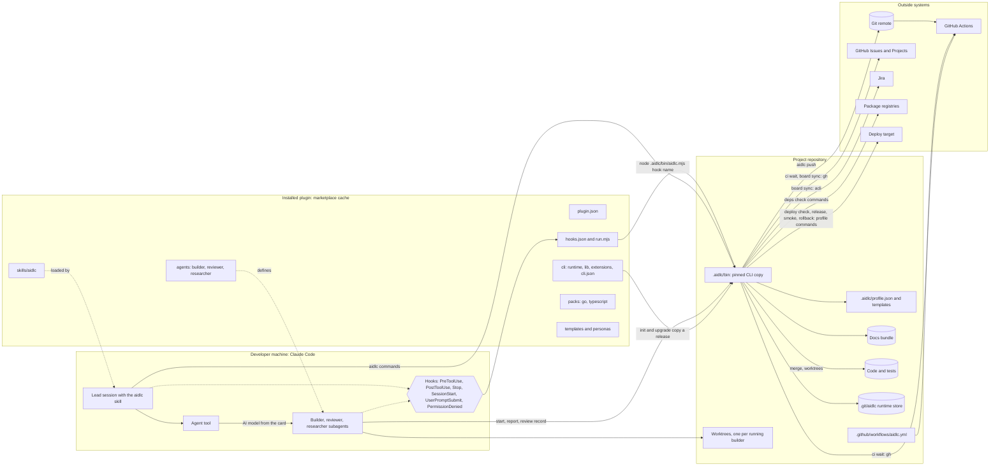

# Parts and connections

# What runs where
| Part | Where | Does |
|---|---|---|
| Lead session | Claude Code, the owner's terminal | Runs the loop: `aidlc next`, does that one step, starts agents in one message |
| Subagents | Claude Code, each in its own worktree for builders | Build, review or research one card or brief; record results through the CLI |
| Hooks | Each tool call and session start, stop or prompt | `guard` (Bash), `scope` and `secrets` (edits), `model` (agent launch: checks the AI model, adds the card), `heartbeat` (every call), `docs` (after edits), `steer` (stop), `status` (session start), `prompt` (owner prompts), `denied` (refused commands) |
| `run.mjs` | Installed plugin | Finds the project, runs the pinned CLI's hook; without one, denies a tool call and lets the other hooks pass |
| Pinned CLI | `.aidlc/bin` in the project, committed | The only place rules run, so every machine and CI use one version ([Vendoring](../vendoring.md)) |
| CLI runtime | `aidlc.mjs` | Parses the command, calls the library, renders data as text or JSON |
| Library | `lib/`: foundation kits, domains, public entry | State, plan, cards, gate, reviews, approvals, hooks' rules; values in `cli.json` ([C4 components](../diagrams/cli-components.md)) |
| Extensions | `extensions/`, each with its `extension.json` | the board, API contracts, intake, Jira, architecture models, Deployment and Operation, slices, stack packs; plug into named seams, never imported by the core ([Library and extensions](../library.md)) |
| Runtime store | `.git/aidlc`, never committed | Cards, reports, reviews, gate results, deploy records, CI record, heartbeat and launch marks, owner prompts, stats |
| Project CI | GitHub Actions | `aidlc check --ci`: the base history since adoption, architecture, the docs |

# Limits
- Node 24 or later, no dependencies; the CLI's core and each extension within a line budget ([Overview](../overview.md#budgets-hard-limits)).
- A blocking hook adds at most 500 ms; a hook that fails never blocks an advisory hook ([Hook mechanics](../hooks.md)).
- Logins belong to the outside tools: `gh` for GitHub, `acli` for Jira.

Logical blocks: [Logical view](logical.md). One bolt in motion: [Runtime view](runtime.md).
