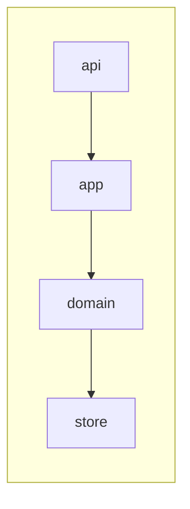
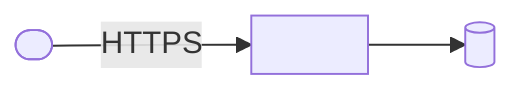

# Logical
<the vertical slices and the horizontal layers inside them: what each slice owns and how slices talk (public APIs, events); no technology>

# Technical
<the processes, stores, identities and the platform they run on, with the protocol on each edge>

# Why
<the decisions these diagrams follow, linked>
